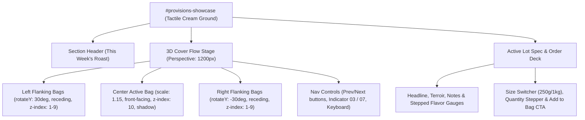

# Day Three — 3D Cover Flow Product Section Design

## 1. Overview & Objective
Transform the *This Week's Roast* section (`#provisions-showcase`) into an interactive **3D Cover Flow Stage** inspired by the album vinyl rack reference.

The objective is to make the 7 vibrant Little Amps packaging packshots the absolute hero of the catalog while providing a tactile, high-engagement ordering experience on the brand's tactile cream (`#FAF8F5`) ground with paper texture.

---

## 2. Approaches Considered

| Approach | Description | Trade-offs | Status |
| :--- | :--- | :--- | :--- |
| **Option A: Warm Cream Atelier** *(Selected)* | 3D Cover Flow stage on the brand's tactile cream (`#FAF8F5`) paper ground with subtle hairlines and coffee stains. | Seamless site continuity; vibrant bag colorways (brick, espresso, sky blue, mustard, olive, peach, plum) pop crisply against light paper. | **Chosen by User** |
| **Option B: Dark Stage** | Deep espresso/black background (`#1A1311`) for the section with spotlight glow. | Dramatic theater feel, but breaks the section flow between cream sections and clashes with the Little Amps light register. | **Rejected** |

---

## 3. Interaction & Motion Architecture

### 3.1 3D Stage Formula
For any card at index `i` with current `activeIndex`:
- `offset = i - activeIndex`
- **Active Card (`offset === 0`)**:
  - `transform: translateX(0) translateZ(0) scale(1.15) rotateY(0deg)`
  - `z-index: 10`, full opacity `1`, elevated drop shadow
- **Left Cards (`offset < 0`)**:
  - `transform: translateX(calc(offset * 180px - 40px)) translateZ(calc(offset * -50px)) scale(calc(1 - abs(offset) * 0.12)) rotateY(30deg)`
  - `z-index: 10 - abs(offset)`
  - `opacity: abs(offset) > 2 ? 0.35 : 0.85`
- **Right Cards (`offset > 0`)**:
  - `transform: translateX(calc(offset * 180px + 40px)) translateZ(calc(offset * -50px)) scale(calc(1 - abs(offset) * 0.12)) rotateY(-30deg)`
  - `z-index: 10 - abs(offset)`
  - `opacity: abs(offset) > 2 ? 0.35 : 0.85`

### 3.2 Interaction Modes
- **Click to Focus**: Clicking any flanking card animates it smoothly to the center.
- **Controls**: Arrow buttons `←` and `→` advance lots; live indicator shows `01 / 07`.
- **Keyboard**: Left/Right arrow keys navigate when the stage has focus.
- **Swipe / Drag**: Pointer / touch swipe support on mobile devices.
- **Reduced Motion**: Gracefully falls back to flat scaling and clean horizontal translation without 3D rotation (`prefers-reduced-motion: reduce`).

---

## 4. Active Lot Spec & Order Deck

Directly below the 3D stage, the selected coffee's details update smoothly:
1. **Headline Block**:
   - Lot Name: Large Fraunces 500 serif (`Uraga Natural`, `Dhaka Daily`, etc.).
   - Origin & Region: `Guji, Ethiopia · Uraga, Guji Zone`.
   - Category badge: `Single Origin` / `House Blend` / `Seasonal Lot`.
2. **Key-Value Ledger (Mirroring reference layout)**:
   - **Process**: `Natural` / `Washed` / `Pulped Natural`
   - **Altitude**: `2,100 – 2,300 MASL`
   - **Roast Date**: `21.10.2026 (Tuesday · Dispatched same day)`
   - **Tasting Notes**: `Blueberry jam · Wildflower honey · Bergamot`
3. **Sensory Analog Flavor Gauges**:
   - Stepped analog bars for `Sweetness`, `Acidity`, and `Complexity` (values 1–4).
4. **Order Row**:
   - Size toggle: `250g` (default) / `1kg` with dynamic price update.
   - Quantity stepper: `[-] 1 [+]` (1–999).
   - Primary CTA: **Add to Bag** styled with the active lot's accent color, triggering cart opening and particle confirmation.

---

## 5. Technical Contracts & Parity Guard

- **Zero Runtime Dependencies**: Pure React 19 hooks and CSS transforms.
- **Strict Parity Checks**:
  - Maintain all legacy IDs: `#provisions-showcase`, `#lots-grid`, `#lots-prev`, `#lots-next`, `#lots-indicator`.
  - Maintain all copy blocks and token classes for `scripts/check-parity.mjs --strict`.
  - Update `FROZEN_CSS_SHA` in `check-parity.mjs` upon CSS modifications.
- **Responsive Behavior**:
  - Desktop (>1024px): 7 cards visible in full 3D Cover Flow arc.
  - Tablet (768px–1024px): 3–5 cards in tighter arc.
  - Mobile (≤768px): Active card front-and-center, subtle peek of flanking cards, touch swipe enabled.

